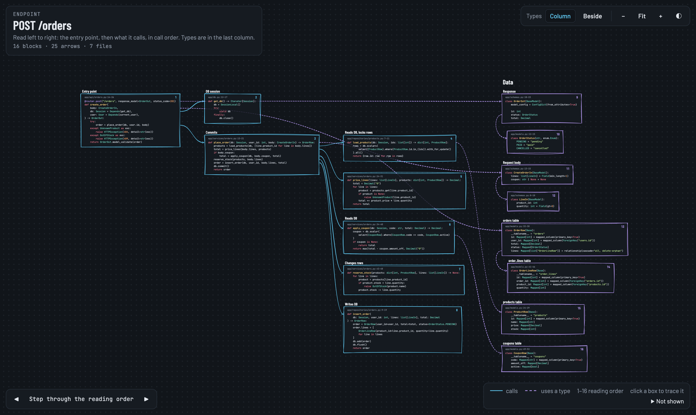
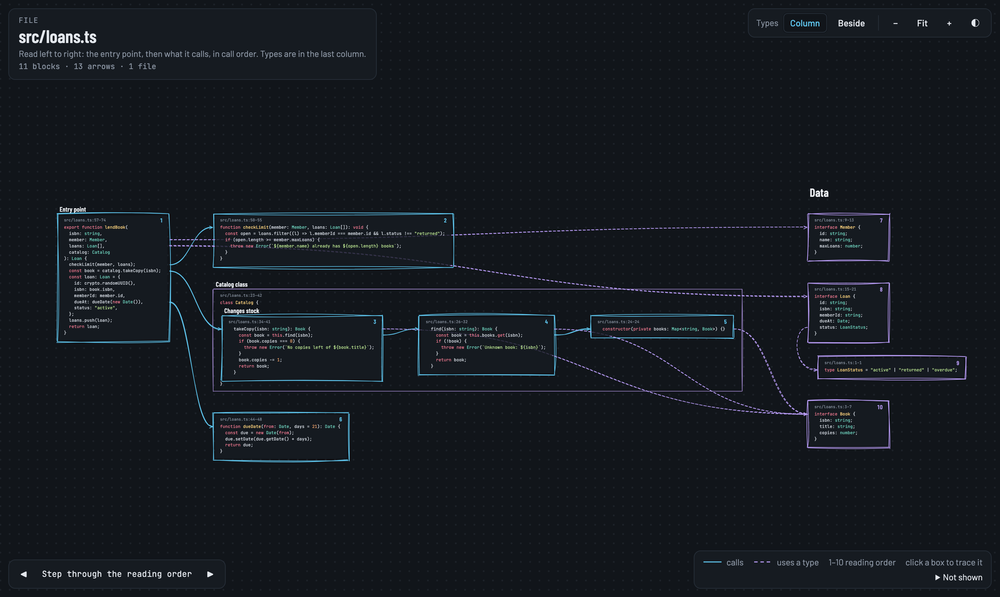
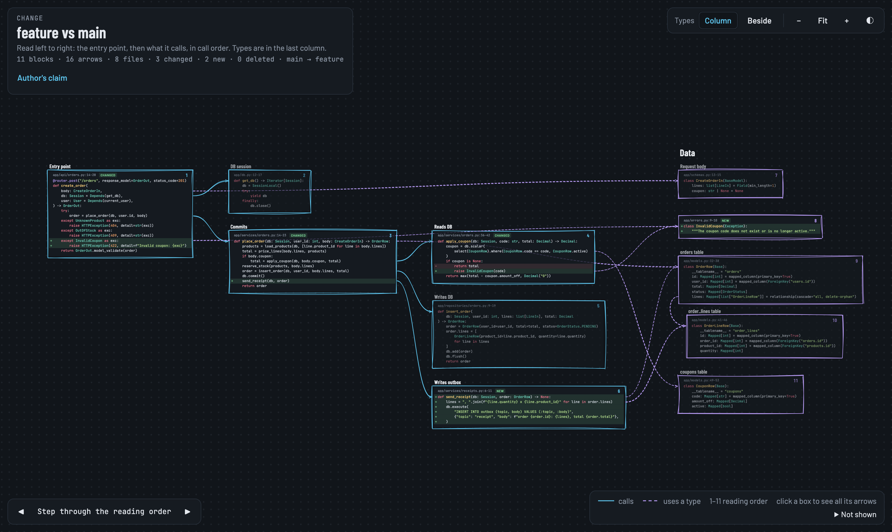

# code-breakdown

[](https://github.com/tukka25/code-breakdown/actions/workflows/tests.yml)

Ask your coding agent to break down a file, an HTTP endpoint or a pull request, and get a canvas of the **real code**. The code is cut at declaration boundaries and laid out in the order it runs: the entry point, then what it calls, then the types it uses. You get the code itself, not an essay about it.



## Why

AI-written code tends to look tidy until you try to follow it. Prose summaries of it are confident and can't be checked. GitHub shows a PR's files in alphabetical order, and reviewers miss more when they read in the wrong order. So this skill shows the pieces and the flow, in the order a reader needs them.

The agent never types code into the picture. It picks line ranges and declares arrows, and a script cuts the text from your files and rejects any range or arrow that doesn't match the code.

## Install

### Claude Code, as a plugin

```
/plugin marketplace add tukka25/code-breakdown
/plugin install code-breakdown@code-breakdown
```

Then run `/code-breakdown:breakdown POST /orders`, or just ask: "break down POST /orders".

### Claude Code, as a personal skill

```bash
git clone https://github.com/tukka25/code-breakdown.git
mkdir -p ~/.claude/skills
ln -s "$PWD/code-breakdown/skills/breakdown" ~/.claude/skills/breakdown
```

Then run `/breakdown POST /orders`. Copying the folder works too, if you'd rather not link it. To share the skill with one repository's team, copy `skills/breakdown` into that repository's `.claude/skills/` and commit it.

### Codex

```bash
git clone https://github.com/tukka25/code-breakdown.git
mkdir -p ~/.agents/skills
ln -s "$PWD/code-breakdown/skills/breakdown" ~/.agents/skills/breakdown
```

For a single repository, put it in that repository's `.agents/skills/breakdown` instead. Then type `$breakdown POST /orders`, pick it from `/skills`, or just ask. You can also ask Codex's built-in `$skill-installer` to install it from `https://github.com/tukka25/code-breakdown/tree/main/skills/breakdown`.

### claude.ai or Claude Desktop: export the skill as a zip

```bash
cd code-breakdown/skills
zip -r breakdown.zip breakdown
```

Upload `breakdown.zip` in Settings, under Skills (code execution must be on). In the chat it works on code you upload. Pull requests need a repository with git, so use Claude Code or Codex for those.

### Other agents

Any agent that reads the Agent Skills format, a folder with a `SKILL.md`, can use `skills/breakdown`. Put the folder wherever that agent loads skills from.

## Use it

| You ask | You get |
|---|---|
| `/breakdown src/loans.ts` | The file's entry point and everything it reaches inside the file |
| `/breakdown POST /orders` | The route handler and everything it calls, across files |
| `/breakdown #42` or "walk me through feature/coupons vs main" | The changed code in call order, with unchanged neighbours dimmed |
| Add `--excalidraw`, or say "as Excalidraw" | A `breakdown.excalidraw` file as well |
| Add `--beside` | Opens with each type under the first code that uses it |

Each run writes one folder at the root of your repository:

```
.breakdown/2026-10-18-endpoint-post-orders/
  canvas.html            open it in any browser; works offline
  tree.json              the checked blocks, arrows and layout
  spec.json              the spec, to render it again later
  breakdown.excalidraw   only when you asked for it
```

The first run adds `.breakdown/` to `.git/info/exclude`, so breakdowns never end up in a commit and your `.gitignore` stays untouched. That is the only write outside `.breakdown/`; ask for `--no-exclude` to skip it.

### Reading the canvas

- **Order:** read left to right. Numbers give the reading order, and ◀ ▶ (or the arrow keys) steps through it.
- **Arrows:** solid arrows are calls, and dashed ones are type uses. Each arrow leaves from the exact line that makes the call.
- **Tracing:** click a box to trace it. Everything it touches lights up, and so do the lines involved.
- **Types:** **Column** (the default) puts every type in a final Data column. **Beside** moves each type under its first user.
- **Moving around:** drag to pan. Scroll to move, Ctrl/⌘ plus scroll or a pinch to zoom, and Fit to see everything.
- **Files:** each box's caption (`file:lines`) opens the file in VS Code.
- **Not shown:** this panel lists what a static picture can't tell you.
- **For a pull request or a branch:**
  - Added lines get a `+` gutter. Lines the change removed or replaced appear in place, marked `−`, so you see the old behaviour next to the new.
  - Boxes are marked new, changed or deleted. Unchanged neighbours are dimmed.
  - An arrow that leaves a changed line always shows.
  - **Author's claim** quotes the author's own words exactly: the PR's title and description, or, for a branch with no PR, its commit messages. The agent never writes its own summary.





## How it works

```
agent reads the code
      │
      ▼
.breakdown/spec.json           blocks as file + line range, arrows between them
      │
      ▼
breakdown.py check  ─────────▶ errors, each with a concrete fix ──▶ agent fixes, checks again
      │
      ▼
breakdown.py render ─────────▶ canvas.html, tree.json, breakdown.excalidraw (on request)
```

The check:

- requires each range to start at its declaration, and points at the right line when it doesn't;
- extends a block upward over its decorators (including ones spread over several lines) and doc comments;
- rejects a block that stops part-way (by indentation in Python, by brackets elsewhere);
- rejects a Python block that runs into the next declaration, and warns about the same in brace languages;
- rejects overlapping blocks and methods outside their class;
- rejects an arrow whose target isn't named in the source block's code (comments and docstrings don't count), unless `via` gives the exact text that reaches it;
- rejects labels that judge the code ("robust", "clean"), since labels only name a role ("Entry point", "Writes DB");
- lists names a block mentions with no arrow drawn, and functions or classes it mentions that no block covers, so missing pieces get noticed.

Both layouts are computed once in Python, so the canvas and the Excalidraw file match. The page embeds its fonts (JetBrains Mono, Barlow Condensed, Barlow) and rough.js, so it needs no network.

## Run it without an agent

```bash
python3 skills/breakdown/scripts/breakdown.py render examples/fastapi-orders/spec.json \
  --root examples/fastapi-orders --open
```

The spec format is in [skills/breakdown/references/spec-format.md](skills/breakdown/references/spec-format.md), and both examples have one.

## Requirements

- Python 3.9 or newer. The scripts use only the standard library.
- git. `gh` is also needed to show a pull request's title and description.
- A browser for the canvas. For the optional drawing, Excalidraw at excalidraw.com or the VS Code Excalidraw extension.

## Development

```bash
python3 -m unittest discover -s tests -t .
```

The tests cover the checks, both layouts, HTML escaping, output naming, the Excalidraw file, and PR change markers against a temporary git repository. If Chrome is installed, they also load each example canvas in headless Chrome.

```
skills/breakdown/       the skill: SKILL.md, references/, scripts/, assets/
examples/               a FastAPI endpoint and a TypeScript file, each with a spec.json
tests/
docs/design.md          the design
docs/research/          the research behind it
.claude-plugin/         plugin and marketplace manifests for Claude Code
```

## Credits

- The idea comes from a [graphicule.dev reel](https://www.instagram.com/reel/DeKWvd1BAX-/): parse code into blocks, rearrange them semantically, and read the result as a storyline.
- Bundled: [rough.js](https://github.com/rough-stuff/rough) (MIT), plus [JetBrains Mono](https://github.com/JetBrains/JetBrainsMono), [Barlow and Barlow Condensed](https://github.com/jpt/barlow) (SIL Open Font License 1.1). Their licences are in `skills/breakdown/assets/vendor/`.

## License

[MIT](LICENSE)
